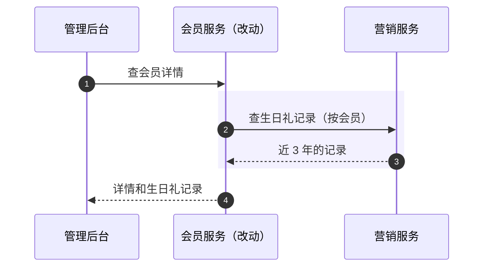
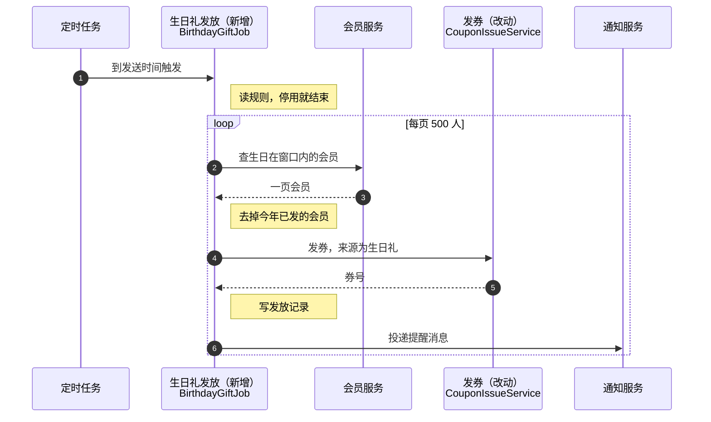
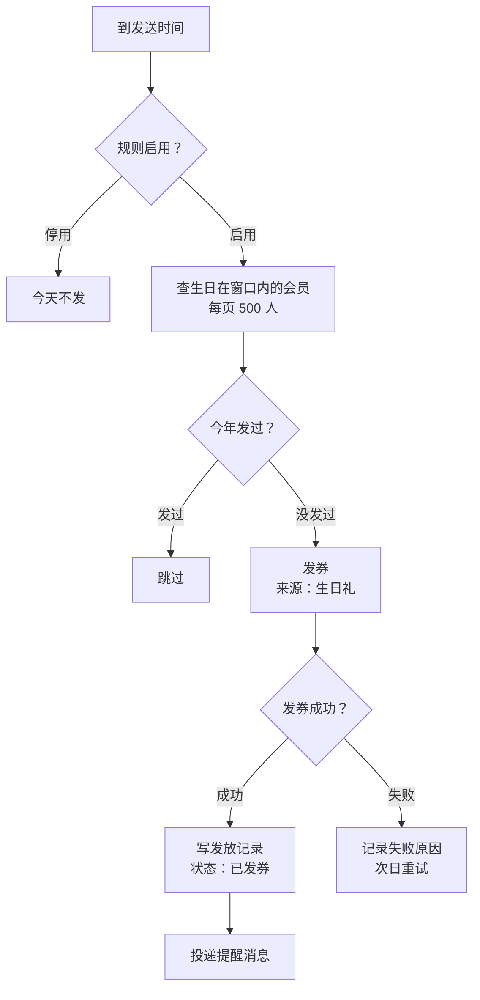
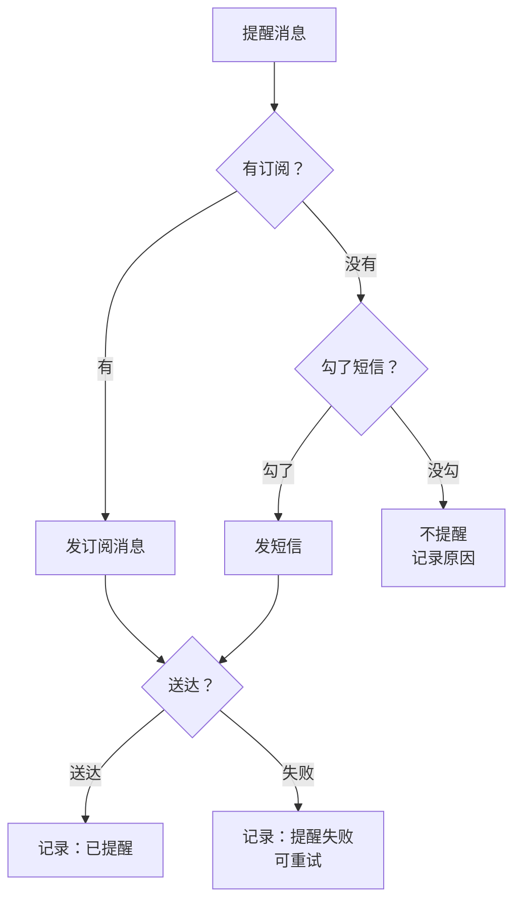
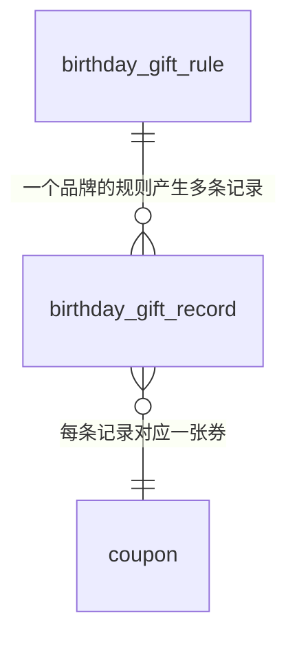
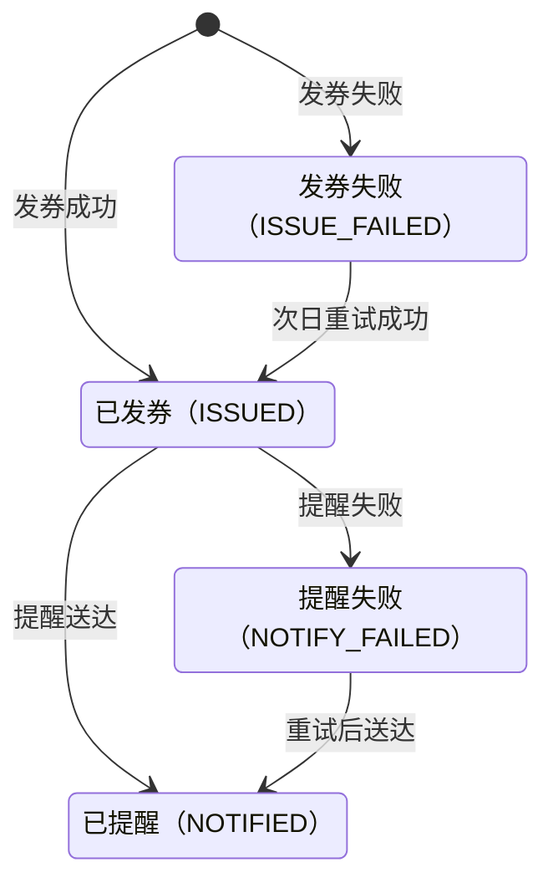

## 0 概述

### 0.1 一页看懂

> [!TIP] 结论
> 可以做，约 6 人日。营销服务新增规则和每天一次的批量发放任务，发券复用现有接口（来源记为「生日礼」），提醒复用现有通知通道；会员服务新增按生日分页查询。开工前要产品拍板 B1、B2。

::: kpi
- **3** 个场景 | 配置、每日发放、提醒
- **2** 个服务改动 | marketing、member
- **2** 张新表 | 规则、发放记录
- **2** 项待拍板 | B1、B2 {warn}
- **6** 人日 | 后端估算
:::

#### 关键设计

::: cards num
- **每天一次批量发放** 生日是固定日期，不需要实时触发；每天在发送时间跑一次，分页处理，重跑安全（决策 1）。
- **发券和提醒分开** 发券成功就写记录；提醒异步投递，失败只记录、可重试，不回滚券（决策 2）。
- **一年只发一次靠唯一键** 发放记录以「会员 + 年份」唯一，任务重跑、重复触发都不会多发（决策 3）。
:::

#### 开工前要拍板

- B1 2 月 29 日生日的会员平年什么时候发 【产品】
- B2 发送时间能否由运营配置，不按 PRD 的 0 点 【产品】【短信平台】

#### 主要风险

| 风险 | 影响 | 应对 |
|---|---|---|
| 某一天生日的人集中 | 发放量是平时的 3 倍左右【推断】 | 分页、限速，任务 1 小时内完成 |
| 短信余额不足 | 短信提醒失败 | 券不受影响；余额告警，失败可重试 |

### 0.2 背景与范围

背景、角色和业务规则见[需求设计](#top-req)。本方案覆盖需求 RQ-1 至 RQ-5；RQ-6（发放统计报表）放到二期。

| 场景 | 配置位置 | 触发时机 | 处理方式 |
|---|---|---|---|
| 配置生日礼 | 营销 › 生日礼（P1） | 运营保存 | 校验后写规则表，次日生效 |
| 每日发放 | — | 每天发送时间 | 定时任务分页发券、写记录 |
| 提醒 | P1 的提醒渠道 | 发券成功后 | 异步投递：订阅消息优先，其次短信 |

### 0.3 与 PRD 的差异

见需求设计 §6（G1 发送时间）。技术方案没有新发现的冲突。

## 1 总体设计

改动集中在营销服务：新增规则、发放任务和发放记录，发券接口只加一个来源。关键取舍记在[决策记录](#top-decision)。

### 1.1 改动全貌

::: board 改动集中在营销服务，通知整条复用
- **营销服务 marketing** 本次主要改动
  - 【新增】生日礼规则 | 表、查询和保存接口
  - 【新增】每日发放任务 | 定时任务，分页处理
  - 【新增】发放记录 | 会员和年份唯一
  - 【修改】发券接口 | 增加来源「生日礼」
- **会员服务 member**
  - 【新增】按生日查会员 | 分页接口，按月日索引
  - 【修改】会员详情接口 | 增加生日礼记录
- **通知服务 notify**
  - 【复用】订阅消息 | 现有模板通道
  - 【复用】短信 | 现有通道，按余额扣费
- **管理后台 admin-web**
  - 【新增】生日礼设置页 | P1
  - 【修改】会员详情页 | P2
:::

::: explain
- **营销服务** 生日礼是一种营销规则，放在营销服务里，和现有营销活动共用发券和权限。
- **会员服务** 只新增一个查询接口和一个详情字段，不保存生日礼数据。
- **通知服务** 不改代码：生日提醒用新的模板，通道、扣费、送达回执都是现成的。
:::

| 服务 | 模块或类 | 改动 | 类型 | 场景 |
|---|---|---|---|---|
| marketing | `BirthdayGiftRuleController` | 查询、保存规则 | 【新增】 | 配置 |
| marketing | `BirthdayGiftJob` | 每日发放任务 | 【新增】 | 每日发放 |
| marketing | `CouponIssueService` | 发券来源增加「生日礼」 | 【修改】 | 每日发放 |
| member | `MemberQueryController` | 按生日分页查询 | 【新增】 | 每日发放 |
| member | `MemberDetailAssembler` | 详情增加生日礼记录 | 【修改】 | 查看 |

### 1.2 上下游影响

| 方向 | 系统或模块 | 影响 | 风险 |
|---|---|---|---|
| 上游 | 会员资料 | 只读生日字段 | 【低】 |
| 下游 | 通知服务 | 每天多一批提醒，峰值约 5 千条【推断】 | 【低】 |
| 下游 | 短信平台 | 夜间不发营销短信（接口文档 v2.1） | 【中】 |

### 1.3 总体架构

::: arch 生日礼只改营销和会员服务，通知走现有通道
- **管理后台** 运营配置、客服查询
  - 生日礼设置页 【新增】 | P1
  - 会员详情页 【修改】 | P2
- **业务服务**
  - 营销服务 marketing 【修改】 | 规则、发放任务、发放记录、发券来源
  - 会员服务 member 【修改】 | 按生日查会员、详情字段
- **通知**
  - 通知服务 notify 【复用】 | 订阅消息、短信
- **外部平台** {ext}
  - 微信订阅消息 【三方】 | 模板消息
  - 短信平台 【三方】 | 夜间不发营销短信
:::

::: explain
- **管理后台** 设置页直接调营销服务；会员详情页调会员服务，会员服务再向营销服务取记录（§2.2）。
- **业务服务** 发放任务在营销服务里运行，向会员服务分页拉人，发券在本服务内完成（§3.1）。
- **通知** 营销服务把提醒投递到通知服务的队列，通知服务按渠道发出并回执（§3.2）。
:::

### 1.4 公共能力

- **发券来源**：`CouponIssueService` 的来源枚举增加 `BIRTHDAY_GIFT`，券流水按来源统计核销率。
- **提醒模板**：通知服务新增一个订阅消息模板和一个短信模板，变量为会员昵称、券名称、到期日。

## 2 配置端设计

页面怎么变见「原型交互」里的 P1、P2，正文里的编号点一下就会切过去。本章写页面背后的接口、字段、校验和存储。

### 2.1 生日礼设置（P1）

#### 接口 【研发】

| 接口（前端路径） | 方法 | 说明 | 类型 |
|---|---|---|---|
| `/marketing/birthday-gift/rule` | GET | 查询本品牌的规则，没有时返回默认值 | 【新增】 |
| `/marketing/birthday-gift/rule` | PUT | 保存规则，次日生效 | 【新增】 |

#### 保存校验 【产品】【研发】【测试】

| 编号 | 校验 | 不通过时 |
|---|---|---|
| CF-1 | 启用时必须选生日券（P1-3），且券模板为可用状态 | 提示「请选择一张可用的生日券」 |
| CF-2 | 提前天数为 0 到 7 的整数（P1-4） | 提示「提前天数为 0 到 7 天」 |
| CF-3 | 发送时间为 9:00 到 20:00 的整点（P1-5） | 提示「发送时间为 9:00 到 20:00 的整点」 |
| CF-4 | 至少勾选一个提醒渠道（P1-6） | 提示「至少选择一个提醒渠道」 |

#### 改动点 【研发】

| 位置 | 改动 | 类型 |
|---|---|---|
| `[marketing] BirthdayGiftRuleController.java` | 查询、保存接口和校验 | 【新增】 |
| `[admin-web] pages/marketing/BirthdayGift.tsx` | 设置页 | 【新增】 |

::: fold 测试要点 【测试】
| 场景 | 验证点 | 对应 |
|---|---|---|
| 未选券保存 | 提示并阻止保存 | CF-1 |
| 选了已停用的券模板 | 提示并阻止保存 | CF-1 |
| 提前天数填 8 | 提示并阻止保存 | CF-2 |
| 发送时间 21:00 | 下拉里不可选 | CF-3 |
| 停用后保存 | 次日起不发放，已发的券不变 | BR-1、AC-2 |
:::

### 2.2 会员详情（P2）

会员详情接口原来只由会员服务组装；现在多一步，向营销服务取生日礼记录。



::: explain
- **1** 管理后台调用现有的会员详情接口，入参不变。
- **2–3** 新增部分（紫框）：会员服务按会员 ID 向营销服务取近 3 年的记录；营销服务超时 300 毫秒或出错时返回空列表，详情照常展示。
- **4** 响应里多一个 `birthdayGifts` 字段，前端据此画 P2-1 和 P2-2。
:::

## 3 场景设计

每个场景按同一结构展开：场景概况、业务规则、处理流程、改动点、异常与边界，最后是默认折叠的测试要点和现状调用链，点开查看。

### 3.1 每日发放

::: facts
- **触发** 每天发送时间（默认 10:00），定时任务
- **处理粒度** 每页 500 个会员
- **量级** 平时每天约 1,650 人，峰值约 5 千人【推断】
- **涉及服务** marketing、member
- **需求** RQ-2；验收标准 AC-1 至 AC-3
:::

#### 业务规则 【产品】【测试】

| 编号 | 规则 | 说明 |
|---|---|---|
| BG-1 | 发放窗口 = 今天 + 提前天数 | 提前 3 天时，今天发给 3 天后生日的会员（BR-3） |
| BG-2 | 发放前查发放记录，今年发过就跳过 | 实现 BR-1；记录以「会员 + 年份」唯一 |
| BG-3 | 发券失败的会员次日重试，最多 3 天 | 超过 3 天记为失败，运营可在会员详情看到 |

#### 处理流程 【研发】



::: explain
- **1** 每个品牌一个任务，在规则的发送时间触发；规则停用时直接结束（BR-4）。
- **2–3** 向会员服务分页拉人，条件是生日的月日等于「今天 + 提前天数」（BG-1）。
- **4–5** 发券复用现有接口，只多传一个来源；券的有效期按 BR-5 计算。
- **6** 提醒异步投递，不等结果；提醒失败不影响券（决策 2）。重跑整个任务也安全：已发的会员在拉人后就被去掉（决策 3）。
:::



::: explain
- **今年发过？** 查发放记录的唯一键，命中就跳过，这是「一年只发一次」的保证（BR-1）。
- **发券成功？** 失败时记录原因，次日任务会再次选中这个会员，最多重试 3 天（BG-3）。
- **投递提醒消息** 只投递不等待，提醒的处理见 §3.2。
:::

#### 改动点 【研发】

| 位置 | 改动 | 类型 |
|---|---|---|
| `[marketing] BirthdayGiftJob.java` | 每日发放任务 | 【新增】 |
| `[marketing] CouponIssueService.java:88` | 来源枚举增加 `BIRTHDAY_GIFT` | 【修改】 |
| `[member] MemberQueryController.java:41` | 按生日月日分页查询 | 【新增】 |

#### 异常与边界 【产品】【研发】【测试】

| 情况 | 处理 | 运营看到 |
|---|---|---|
| 券模板在发放前被停用 | 本次不发，记录原因 | 设置页提示「生日券已不可用」 |
| 会员服务超时 | 本页重试 3 次，仍失败则任务中止，下一小时补跑 | 无感知；告警给研发 |
| 2 月 29 日生日的会员（平年） | 按 B1 的结论处理，默认按 2 月 28 日 | 无 |

::: fold 测试要点 【测试】
| 场景 | 验证点 | 对应 |
|---|---|---|
| 提前 3 天、10:00 | 3 天后生日的会员在 10:00 收到券 | AC-1、BG-1 |
| 当年已发 | 任务重跑不再发券 | AC-2、BG-2 |
| 没填生日 | 不在拉人结果里 | AC-3 |
| 发券失败 | 次日重试，最多 3 天 | BG-3 |
:::

<details><summary>现状调用链</summary>

```text
现有营销活动发券：[marketing] CampaignIssueJob.java:56 run
  → [marketing] CouponIssueService.java:88 issue(memberId, templateId, source)
  → [marketing] CouponRepository.java:40 insert
```

</details>

### 3.2 发放提醒

::: facts
- **触发** 发券成功后投递的提醒消息
- **处理粒度** 一条消息一个会员
- **涉及服务** marketing、notify
- **需求** RQ-3、RQ-4；验收标准 AC-4
:::



::: explain
- **有订阅？** 会员订阅了生日提醒模板就发订阅消息，不花钱；没有订阅才考虑短信。
- **勾了短信？** 由 P1-6 的提醒渠道决定；短信按条扣余额。
- **送达？** 以通知服务的回执为准；失败的记录在会员详情里可见，运营可以手动重试一次。
:::

#### 异常与边界 【产品】【研发】【测试】

| 情况 | 处理 | 会员看到 |
|---|---|---|
| 短信余额不足 | 提醒失败，券不受影响；余额告警 | 券在账户里，没有提醒 |
| 21:00 以后才轮到发短信 | 留到次日 9:00 发 | 次日上午收到短信 |

## 4 数据与接口

### 4.1 数据模型及存储设计

| 库 | 表 | 变更 | 类型 | 说明 |
|---|---|---|---|---|
| marketing | `birthday_gift_rule` | 一个品牌一条：券模板、提前天数、发送时间、渠道、启用 | 【新增】 | 唯一键 `brand_id` |
| marketing | `birthday_gift_record` | 一个会员一年一条：券号、状态、失败原因 | 【新增】 | 唯一键 `member_id, gift_year` |
| member | `member` | 新增生成列 `birth_md`（月日）并加索引 | 【修改】 | 按生日查询用 |



::: explain
- **birthday_gift_record** 唯一键 `member_id, gift_year` 保证一年一条（决策 3）；`coupon` 是现有的券表，只读。
:::



::: explain
- **已发券** 券已经在会员账户里；之后的提醒成败只改状态，不动券（决策 2）。
- **发券失败** 次日任务会重试，3 天后仍失败就停在这个状态，运营可在 P2-1 看到原因。
:::

### 4.2 接口设计

::: switch 接口
#### 保存规则
```json
{
  "enabled": true,
  "couponTemplateId": 2041,
  "advanceDays": 3,
  "sendHour": 10,
  "channels": ["SUBSCRIBE", "SMS"]
}
```
#### 提醒消息
```json
{
  "bizType": "BIRTHDAY_GIFT",
  "memberId": 880001,
  "couponName": "生日满 50 减 10 券",
  "expireAt": "2026-04-01T23:59:59+08:00",
  "channels": ["SUBSCRIBE", "SMS"]
}
```
:::

### 4.3 并发、幂等与异常处理

| 项 | 设计 |
|---|---|
| 幂等 | 发放记录唯一键 `member_id, gift_year`；先写「发放中」占位再发券，重复插入即跳过 |
| 并发 | 一个品牌一个任务，分布式锁防止同一品牌并发执行 |
| 重试 | 发券失败次日重试，最多 3 天；提醒失败由运营手动重试一次 |

### 4.4 容量与内存评估

::: switch 规模
#### 现在
| 项 | 估算 |
|---|---|
| 会员数 | 100 万，填了生日约 60%【推断】 |
| 每天发放 | 约 1,650 人，峰值约 5 千人 |
| 任务耗时 | 每人约 20 毫秒【推断】，峰值约 2 分钟 |
#### 十倍会员
| 项 | 估算 |
|---|---|
| 会员数 | 1,000 万 |
| 每天发放 | 约 1.65 万人，峰值约 5 万人 |
| 任务耗时 | 单线程约 17 分钟；按品牌并行后约 5 分钟 |
:::

## 5 可用性评估与保障

### 5.1 监控和告警

| 监控项 | 规则 | 阈值 | 级别 |
|---|---|---|---|
| 发放任务未完成 | 发送时间后 30 分钟仍在运行 | 1 次 | P2 |
| 发券失败率 | 当天失败 ÷ 应发 | > 1% | P2 |
| 提醒失败率 | 当天失败 ÷ 已发券 | > 5% | P3 |

### 5.2 灰度、降级和回滚

| 项 | 方案 |
|---|---|
| 灰度 | 按品牌开启：先开一个品牌，观察一周 |
| 降级 | 关闭规则开关即停发；通知服务异常时只停提醒 |
| 回滚 | 服务回滚到上一版本；新表保留，不影响旧逻辑 |

### 5.3 数据处理方案

上线不需要补历史数据；今年已经手工发过生日券的会员，由运营导入名单写入发放记录，避免重复发。

### 5.4 信息安全、权限评估

设置页沿用营销菜单的权限；提醒消息里不放手机号，由通知服务按会员 ID 取号。

### 5.5 资金安全保障

券由现有发券接口发放，受券模板的总量和预算控制；短信费用按余额扣减，余额不足时停发短信。

### 5.6 未来演进

二期按会员等级发不同的券（RQ-6 之外的新需求），规则表增加等级维度即可。

## 6 测试方案

### 6.1 测试范围与环境

测试环境开启一个品牌，用测试会员覆盖：提前 0、3、7 天，生日为空，2 月 29 日生日。

### 6.2 验收用例的变化

| 验收用例 | 原预期 | 本方案预期 | 原因 |
|---|---|---|---|
| AC-1 | 生日当天 0 点收到券和提醒 | 提前 3 天、10:00 收到 | G1、B2 |

### 6.3 补充用例

| 用例 | 预期 |
|---|---|
| 任务执行到一半重启 | 重跑后已发的会员不再发 |
| 同一会员同时满足两个品牌 | 各品牌各发一张 |

### 6.4 回归范围

营销活动发券（发券接口改动了来源枚举）、会员详情页。

## 7 待确认与风险

### 7.1 开工前必须确认

需求设计里的 B1、B2 待产品确认；技术方案没有新增开工前确认项。

### 7.2 详设阶段确认

| 编号 | 问题 | 现状与依据 | 建议 | 找谁 |
|---|---|---|---|---|
| D1 | 会员表加生成列和索引是否需要走 DBA 评审 | 会员表约 100 万行，在线加列 | 走 DBA 评审，低峰执行 | 【研发】 |

### 7.3 风险

| 编号 | 风险 | 影响 | 应对 | 等级 |
|---|---|---|---|---|
| R1 | 某一天生日的人集中 | 发放量是平时的 3 倍左右 | 分页、限速；任务 1 小时内完成 | 【低】 |
| R2 | 短信余额不足 | 短信提醒失败 | 券不受影响；余额告警 | 【中】 |

## 8 实施计划

### 8.1 工作量

| 服务 | 内容 | 人日 |
|---|---|---|
| marketing | 规则接口、发放任务、发放记录、发券来源 | 4 |
| member | 按生日查询、详情字段、索引 | 1.5 |
| 联调与测试支持 | — | 0.5 |

### 8.2 上线顺序与回滚

::: steps 上线顺序
- **数据库变更** 两张新表、会员表生成列；规则默认停用
- **营销服务、会员服务** 同时发布 {par}
- **管理后台** 设置页和会员详情页上线
- **灰度** 先开一个品牌，观察一周再全量
:::

## 附录 调研依据与参考

### 附录 A 现状调研：代码事实

1. **发券接口已经支持来源参数**。新增枚举值即可（`[marketing] CouponIssueService.java:88`）。
2. **会员生日存为日期**。按月日查询需要生成列和索引（`[member] Member.java:57`）。

### 附录 F 代码基线与文件路径

| 仓库 | 基线 |
|---|---|
| marketing | `origin/master` 7f3e2a1（2026-11-20） |
| member | `origin/master` 4c9d0b2（2026-11-19） |
| notify | `origin/master` e18a6c3（2026-11-18） |
| admin-web | `origin/master` a1b2c3d（2026-11-20） |
