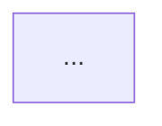

# 组件语法

一个功能只有一份 HTML：`【设计文档】<功能名>.html`，右上角「需求设计」「原型交互」「技术方案」「决策记录」四个按钮切换内容，左侧目录跟着切换。每部分各有一份 Markdown：

| 部分 | 源文件 | 文档头 `doctype` |
|---|---|---|
| 需求设计 | `【需求设计】<功能名>.md` | `需求设计` |
| 原型交互 | `【功能原型】<功能名>.md` 和同名 `.proto.js` | `功能原型` |
| 技术方案 | `【技术文档】<功能名>.md` | `技术方案` |
| 决策记录 | `【决策记录】<功能名>.md` | `决策记录` |

构建任意一份 Markdown，都会找到其他几份（文档头的 `requirement:` / `prototype:` / `design:` / `decisions:`，或者同目录下把前缀换掉的同名文件），合成同一份 HTML；还没写的部分，对应按钮置灰。

下面的写法在 GitHub、IDE 里也能正常阅读：容器的 `:::` 行会显示出来，内容按普通列表、表格、标题渲染。

## 文档头（front matter）

```yaml
---
title: 会员生日礼
doctype: 技术方案            # 需求设计、功能原型、技术方案或决策记录，决定这份内容放进哪个视图
summary: 一句话说明做什么、谁负责什么。
status: 评审中               # 草稿 / 评审中 / 已定稿
version: v1.0
date: 2026-11-24
requirement: 【需求设计】xxx.md # 可选：其他部分的源文件；不写时按同名文件查找
prototype: 【功能原型】xxx.md
design: 【技术文档】xxx.md
decisions: 【决策记录】xxx.md
output: 【设计文档】xxx.html  # 可选：默认 【设计文档】<title>.html
proto: xxx.proto.js          # 原型交互专用：默认取同名 .proto.js
skin: admin                  # 原型交互专用：产品皮肤，默认取本机配置，没有配置时用 admin
parties: 支付平台、短信平台    # 可选：三方负责方，正文里的【支付平台】会渲染成三方标签
meta:                        # 首屏右侧的事实栏，值支持行内 Markdown
  - PRD: 《xxx》
  - 代码基线: 见 §附录F
readers:                     # 首屏的按角色阅读，角色名会渲染成角色色标签
  - 产品: §0 概述；§3 各场景的「业务规则」
  - 研发: §1 至 §4
  - 测试: §6 测试方案
---
```

## 标题与编号

- `## 1 总体设计`：章。首屏下方显示「第一章」标签，`## 0 概述` 显示「总览」，`## 附录 标题` 显示「附录」。
- `### 1.2 上下游影响`：节，编号显示为蓝色。`### 附录 A 标题` 编号为 A。
- `#### 标题 【产品】【测试】`：小节，可以带角色标签。
- 章和节自动进入左侧目录，全部展开。
- `§1.2`、`§附录B` 渲染为跳转链接，悬停显示标题；先找本视图的章节，本视图没有这一节时再找其他视图的同号章节；构建时检查目标是否存在。

## 行内标签

| 写法 | 含义 | 颜色 |
|---|---|---|
| `【新增】` `【修改】` `【改动】` `【不变】` `【复用】` `【现状】` `【删除】` | 改动类型 | 紫、琥珀、灰、红 |
| `【已确认】` `【推断】` `【待确认】` `【阻塞】` `【风险】` | 结论状态 | 绿、描边灰、琥珀、实心红、红 |
| `【被替代】` `【已撤销】` | 决策记录的状态 | 灰 |
| `【高】` `【中】` `【低】` | 风险等级 | 红、琥珀、灰 |
| `【产品】` `【研发】` `【测试】` `【前端】` `【运维】` `【三方】` `【外部】` | 负责方或读者 | 品红、蓝、青、深色描边 |
| `【可选】` `【一期】` `【后续】` | 范围 | 描边、绿、描边 |

文档头 `parties:` 和本机配置里列出的三方名称也会渲染成三方标签。不在词表里的 `【…】` 原样输出（比如短信签名【示例品牌】）。

## 编号与互链

- 表格第一列是编号（`B1`、`D10`、`G3`、`R2`、`RQ-2`、`BR-5`、`AC-3`、`PM-5`、`CF-7`）时，这一行成为锚点；正文里其他地方出现同一编号会自动链接到这一行。
- 原型页 `::: proto P1` 和它的说明 `P1-3` 也会被自动链接：在技术方案里写 `P1-3`，点击后切到「原型交互」并定位到这条说明，原型上的编号同时闪一下。
- 「决策 N」自动链接到决策记录里的那一条，在哪个视图里写都行。
- 每个视图先链接自己的表格行，找不到再链接其他视图：需求设计里定义的 `B1`、`G2`、`RQ-3`，在原型和技术方案里直接写编号就能跳过去。要从一个视图跳到另一个视图的开头，写 `[需求设计](#top-req)`、`[原型交互](#top-proto)`、`[技术方案](#top-design)` 或 `[决策记录](#top-decision)`。
- 代码引用写成 `` `[member] MemberQueryService.java:144` ``：方括号里是仓库名（小写字母、数字、连字符），渲染成小标签，行号不断行。

## 提示块（GitHub alert 语法）

```markdown
> [!TIP] 结论
> 内容。
```

`NOTE` 说明（蓝）、`TIP` 结论（绿）、`IMPORTANT` 重点（深色）、`WARNING` 注意（琥珀）、`CAUTION` 风险（红）。`[!TYPE]` 后面的文字是标题，可省略。

## 容器

容器以 `::: 名称 参数` 开始，以单独一行 `:::` 结束，不能嵌套。

**指标行**：数字、标签、说明；`{warn}` 让数字变琥珀色，`{ok}` 变绿色。

```markdown
::: kpi
- **3** 个场景 | 配置、发放、提醒
- **2** 项待拍板 | 开工前确认 {warn}
:::
```

**卡片**：`num` 显示 01、02 序号；`roles` 把标题渲染成角色标签。

```markdown
::: cards num
- **一年只发一次** 发放记录以会员和年份为键，重试不会重复发券（决策 3）。
- **发券和提醒分开** 提醒失败不影响券，单独重试（决策 2）。
:::
```

**事实栏**：场景概况等键值对。

```markdown
::: facts
- **触发** 每天 9:00 定时任务
- **量级** 每天约 3 千人【推断】
:::
```

**分组看板**：每个一级条目是一列（加粗的是列名，后面可以跟一句说明），二级条目是这一列的事项；开头或末尾的【新增】【修改】【复用】【删除】决定颜色，`|` 后面是补充说明。用来画改动全貌、需求拆解、按负责方分组的待确认，代替思维导图。

```markdown
::: board 改动全貌
- **营销服务 marketing** 本次主要改动
  - 【新增】生日礼规则 | 配置页、保存校验
  - 【修改】发券接口 | 增加来源「生日礼」
- **会员服务 member**
  - 【复用】按生日查会员
:::
```

**分层架构**：每个一级条目是一层（层名加粗，后面可以跟一句说明；`{ext}` 让这一层画成虚线框），二级条目是这一层的组件：`名称 【类型】 | 说明`。层之间自动画向下的箭头，图例按用到的类型生成。

```markdown
::: arch 生日礼只改营销服务
- **运营后台**
  - 生日礼设置页 【新增】 | P1
- **业务服务**
  - 营销服务 【修改】 | 规则、发放任务
  - 会员服务 【复用】 | 按生日查会员
- **外部通道** {ext}
  - 订阅消息、短信 【三方】
:::
```

**步骤**：按顺序编号的竖向时间线，`**标题** 说明`；末尾加 `{par}` 表示这一步里的几件事可以并行。

```markdown
::: steps 上线顺序
- **数据库变更** 建表，开关默认关
- **营销服务、会员服务** 同时发布 {par}
- **灰度** 先开一个品牌
:::
```

**图解**：紧跟在图或组件后面，和它拼成一张卡片；参数是标题，默认「图解」。条目写 `**键** 说明`，键是步骤号、节点名或区域；不写键就是普通条目。

```markdown
::: explain
- **1–2** 每天 9:00 触发，先查出生日在发放窗口内的会员。
- **3** 今年发过的会员直接跳过。
:::
```

**决策**（决策记录）：`决策 N | 标题`，一条记录一个容器。「状态」开头的标签和「日期」显示在标题行右侧，其余条目按顺序排成两列，「选择」加深显示。决策记录里的每一条会进左侧目录。

```markdown
::: decision 决策 1 | 每天一次批量发放，不在会员生日当天实时触发
- **状态** 【已确认】 研发评审定稿
- **日期** 2026-11-24
- **背景** 要解决什么问题，PRD 怎么要求，约束是什么
- **选择** ……
- **理由** ……
- **代价** ……
- **未采用** ……
- **关联** B2、BR-3、§3.1、P1-2
:::
```

**横向切换**：同一块内容的不同状态或情况，用 `####` 分隔各个状态，第一个是默认状态。只用于切换状态，不用于导航。

````markdown
::: switch 视图
#### 改造后

#### 现状
……
:::
````

**折叠小节**：只有部分读者需要逐条看的内容，默认折叠。标题行和 `####` 一样可以带角色标签，右侧自动显示条数（表格行数或列表项数）。技术方案里的「测试要点」都用它。打印时自动展开；从别处跳到折叠内容里时先展开。

````markdown
::: fold 测试要点 【测试】
| 场景 | 验证点 | 对应 |
|---|---|---|
| …… | …… | CF-1、AC-2 |
:::
````

**使用路径**（原型文档）：按任务分组列出原型页。

```markdown
::: journey
- **配置生日礼** 运营在营销菜单里打开生日礼设置。
  - P1 生日礼设置 【新增】
  - P2 会员详情 【改动】
:::
```

**原型页**（原型文档）：`编号 | 页面名 | 新增页面或改动页面`。第一段是页面说明；引用块是「现状」；有序列表是编号说明（序号与原型上的编号一一对应，开头的【新增】【改动】决定编号颜色）；无序列表是改动说明。页面本身由 `.proto.js` 里的 `FRAMES.P1` 绘制。

```markdown
::: proto P1 | 生日礼设置 | 新增页面
运营在这里配置生日礼：送哪张券、提前几天、几点发、用什么渠道提醒。

1. 【新增】**启用开关**。关闭后当天起停止发放，已发的券不受影响。
2. 【新增】**发放时间**。可选 9:00–20:00，整点。

- 前端：新增路由 `/marketing/birthday-gift`。
- 接口：查询、保存规则。
:::
```

## 折叠证据

现状调用链、长代码等证据用 `<details>` 折叠，设计内容保持可见：

````markdown
<details><summary>现状调用链</summary>

```text
XXL job → [marketing] CouponIssueJob.java:32 execute
```

</details>
````

## 图

- ```` ```mermaid title="图名" ```` 构建时渲染成 SVG，图名显示在图下方。怎么选图、怎么写见 `diagrams.md`。
- 流程图节点加 `:::new`（紫，新增）、`:::mod`（琥珀，改动）、`:::keep`（灰）、`:::ext`（虚线，外部系统）、`:::warn`、`:::bad`，构建时自动补 `classDef` 和图例。流程图用 ELK 排版。
- 时序图里新增的步骤用 `rect rgba(107, 78, 255, 0.08)` 包起来，构建时画成紫色虚线框，图例自动显示「新增」；参与者名称含「新增」「改动」「三方」时自动上色。
- 图里的文字不小于 12px：图太宽时在图框内横向滚动，不再缩小。宽度超过约 850px 的图，优先改成 `TB` 方向、减少参与者、缩短标签。
- 每张图下面用 `::: explain` 写图解。

## 已知坑

- CommonMark 的加粗不能以中文标点结尾再紧跟汉字：写 `**标题**。说明`，不要写 `**标题。**说明`。
- 表格单元格里的竖线要写成 `\|`。
- 容器不能嵌套：`::: explain` 要写在 `::: switch` 外面，或者每个状态里只放图。
