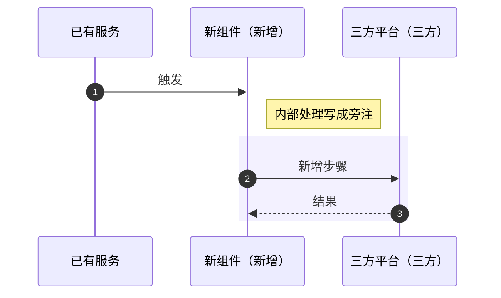
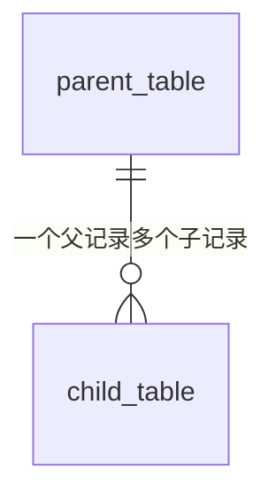

## 0 概述

### 0.1 一页看懂

> [!TIP] 结论
> 能不能做、怎么做（一句话方案）、一期范围、开工前要拍板几项（§7.1）。

::: kpi
- **N** 个场景 | 说明
- **N** 个服务改动 | 说明
- **N** 张新表 | 说明
- **N** 项待拍板 | 开工前确认 {warn}
- **N** 人日 | 后端估算
:::

#### 关键设计

::: cards num
- **设计一** 要解决什么问题，怎么做，代价是什么（决策 1）。
- **设计二** 同上，每张卡片单独看也能懂（决策 2）。
:::

#### 开工前要拍板

- B1 问题 【产品】

#### 主要风险

| 风险 | 影响 | 应对 |
|---|---|---|
| 风险 | 影响 | 应对 |

### 0.2 背景与范围

一段话；有需求设计时引用它，不重复。

| 场景 | 配置位置 | 触发时机 | 处理方式 |
|---|---|---|---|
| 场景 | 位置 | 时机 | 方式 |

本期不做：……

### 0.3 与 PRD 的差异

有需求设计时写「见需求设计 §6」，这里只补充技术方案新发现的冲突。

| 编号 | PRD 位置 | PRD 描述 | 本方案 | 原因 | 状态 |
|---|---|---|---|---|---|
| G1 | 3.4 | 描述 | 方案 | 原因 | 【待确认】 |

## 1 总体设计

本章给出改动全貌。关键取舍记在右上角的[决策记录](#top-decision)，正文里写「决策 N」引用。

### 1.1 改动全貌

::: board 改动全貌：一句话结论
- **服务一** 本次主要改动
  - 【新增】模块或能力 | 补充说明
  - 【修改】模块或能力 | 补充说明
- **服务二**
  - 【复用】模块或能力
:::

::: explain
- **服务一** 为什么改动集中在这里。
- **服务二** 只复用，不改代码。
:::

| 服务 | 模块或类 | 改动 | 类型 | 场景 |
|---|---|---|---|---|
| 服务 | `ClassName` | 改动 | 【新增】 | 场景 |

### 1.2 上下游影响

| 方向 | 系统或模块 | 影响 | 风险 |
|---|---|---|---|
| 上游 | 系统 | 影响 | 【中】 |

> [!CAUTION] 潜在风险
> - 风险点

### 1.3 总体架构

::: arch 总体架构：一句话结论
- **前端**
  - 页面 【新增】 | P1
- **业务服务**
  - 服务一 【修改】 | 改什么
  - 服务二 【复用】 | 提供什么
- **外部系统** {ext}
  - 三方平台 【三方】 | 接口
:::

::: explain
- **业务服务** 调用关系：谁调谁、同步还是异步；具体顺序见 §3 的时序图。
- **外部系统** 依赖的三方接口和版本。
:::

### 1.4 公共能力

客户端、通用组件、变量取值等跨场景的设计。

## 2 配置端设计

页面怎么变见「原型交互」里的 P1 至 Pn，正文里的编号点一下就会切过去。本章写页面背后的接口、字段、校验和存储。

### 2.1 页面名（P1）

#### 接口 【研发】

| 接口（前端路径） | 方法 | 说明 | 类型 |
|---|---|---|---|
| `path` | POST | 说明 | 【新增】 |

#### 保存校验 【产品】【研发】【测试】

| 编号 | 校验 | 不通过时 |
|---|---|---|
| CF-1 | 校验 | 提示 |

#### 改动点 【研发】

| 位置 | 改动 | 类型 |
|---|---|---|
| `[repo] File.java:123` | 改动 | 【修改】 |

::: fold 测试要点 【测试】
| 场景 | 验证点 | 对应 |
|---|---|---|
| 场景 | 验证点 | CF-1、AC-1 |
:::

## 3 场景设计

每个场景按同一结构展开：场景概况、业务规则、处理流程、改动点、异常与边界，最后是默认折叠的测试要点和现状调用链，点开查看。

### 3.1 场景名

::: facts
- **触发** 何时触发
- **处理粒度** 粒度
- **量级** 量级
- **涉及服务** 服务
- **需求** RQ-1；验收标准 AC-1
:::

#### 业务规则 【产品】【测试】

| 编号 | 规则 | 说明 |
|---|---|---|
| XX-1 | 规则（引用 BR-1，补充实现层面的规则） | 说明 |

#### 处理流程 【研发】



::: explain
- **1** 从哪里触发，触发条件。
- **2–3** 新增部分（紫框）：为什么这样做，失败时怎么办。
:::

#### 改动点 【研发】

| 位置 | 改动 | 类型 |
|---|---|---|
| `[repo] File.java:123` | 改动 | 【修改】 |

#### 异常与边界 【产品】【研发】【测试】

| 情况 | 处理 | 用户或运营看到 |
|---|---|---|
| 情况 | 处理 | 提示 |

::: fold 测试要点 【测试】
| 场景 | 验证点 | 对应 |
|---|---|---|
| 场景 | 验证点 | XX-1、AC-1 |
:::

<details><summary>现状调用链</summary>

```text
入口 → [repo] File.java:12  method
```

</details>

## 4 数据与接口

### 4.1 数据模型及存储设计

| 库 | 表 | 变更 | 类型 | 说明 |
|---|---|---|---|---|
| 库 | `table` | 变更 | 【新增】 | 说明 |



::: explain
- **child_table** 新增的表，存什么；关键索引见上表。
:::

### 4.2 接口设计

依赖的外部接口、内部消息；请求示例用横向切换按场景展示：

::: switch 场景
#### 场景一
```json
{"example": 1}
```
#### 场景二
```json
{"example": 2}
```
:::

### 4.3 并发、幂等与异常处理

| 项 | 设计 |
|---|---|
| 幂等 | 做法 |

### 4.4 容量与内存评估

::: switch 规模
#### 当前上限
| 项 | 估算 |
|---|---|
| 项 | 值 |
#### 放开上限
| 项 | 估算 |
|---|---|
| 项 | 值 |
:::

## 5 可用性评估与保障

### 5.1 监控和告警

| 监控项 | 规则 | 阈值 | 级别 |
|---|---|---|---|
| 监控项 | 规则 | 阈值 | P2 |

### 5.2 灰度、降级和回滚

| 项 | 方案 |
|---|---|
| 灰度 | 方案 |
| 降级 | 方案 |
| 回滚 | 方案 |

### 5.3 数据处理方案

### 5.4 信息安全、权限评估

### 5.5 资金安全保障

### 5.6 未来演进

## 6 测试方案

### 6.1 测试范围与环境

### 6.2 验收用例的变化

| 验收用例 | 原预期 | 本方案预期 | 原因 |
|---|---|---|---|
| AC-1 | 预期 | 预期 | G1 |

### 6.3 补充用例

### 6.4 回归范围

## 7 待确认与风险

### 7.1 开工前必须确认

需求设计里已有的问题直接引用编号，这里只列技术方案新发现的。

| 编号 | 问题 | 现状与依据 | 建议 | 找谁 |
|---|---|---|---|---|
| B1 | 问题 | 依据 | 建议 | 【产品】 |

### 7.2 详设阶段确认

| 编号 | 问题 | 现状与依据 | 建议 | 找谁 |
|---|---|---|---|---|
| D1 | 问题 | 依据 | 建议 | 【研发】 |

### 7.3 风险

| 编号 | 风险 | 影响 | 应对 | 等级 |
|---|---|---|---|---|
| R1 | 风险 | 影响 | 应对 | 【中】 |

## 8 实施计划

### 8.1 工作量

| 服务 | 内容 | 人日 |
|---|---|---|
| 服务 | 内容 | N |

### 8.2 上线顺序与回滚

::: steps 上线顺序
- **数据库变更** 先建表，开关默认关
- **服务一、服务二** 同时发布 {par}
- **前端** 页面上线
- **灰度** 先开一部分，观察后全量
:::

## 附录 调研依据与参考

### 附录 A 现状调研：代码事实

1. **事实**。说明（`[repo] File.java:12`）。

### 附录 F 代码基线与文件路径

| 仓库 | 基线 |
|---|---|
| 仓库 | `origin/master` 提交（日期） |
